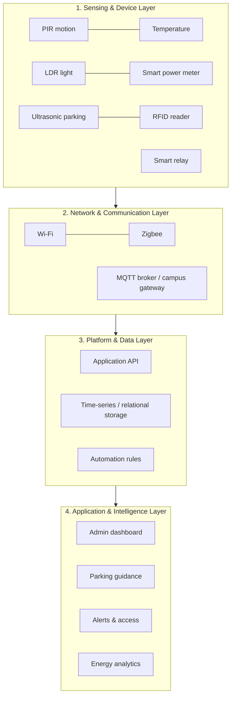

# System Architecture

The reference concept is organized as a four-layer IoT foundation.

## Data flow

1. Sensors measure occupancy, temperature, ambient light, power, vehicle presence and credential events.
2. Edge gateways normalize device payloads and publish telemetry through MQTT.
3. Platform services validate, timestamp and persist events.
4. Automation rules evaluate occupancy and comfort policies before issuing commands to relays.
5. Dashboard modules expose room status, energy trends, parking occupancy and security events.

## Prototype boundary

The checked-in application simulates telemetry and control state in Streamlit session state. It does not connect to campus infrastructure, physical relays, real RFID readers, a broker or a production database.
